# Zero to hero: counting hayd days in the Shafi'i school

This guide teaches you, step by step, how the Shafi'i school decides **which days of bleeding are
hayd (menstruation) and which are not**. You need no prior knowledge. Every lesson starts with a
picture, then the rule, then the source. At the end there are exercises.

Nothing here is new: the guide retells, in teaching order, what the other files in `docs/fiqh/`
say (the details, the Arabic wording and every open point are there). It follows the views the
calculator uses by default. Where the school has other views, they are shown next to them.

---

## How to read the pictures

Each symbol is **one day** (a full day and night, 24 hours), read from left to right. The days are
grouped in fives, and the small numbers above them count the days.

The first row shows **what she sees**. Every kind of discharge is a drop:

| | |
|---|---|
|  | black blood |
|  | red blood |
|  | yellow discharge |
|  | clean: no blood at all |

The second row shows **the ruling**:

| | |
|---|---|
|  | **hayd**: no prayer, no fasting |
|  | **clean and pure (tuhr)**: she prays and fasts (the same square as a clean day) |
|  | **blood that is not hayd** (istihada or "dam fasad"): she still prays and fasts |

Example: 3 days of red blood, 12 clean days, 3 days of red blood.

<!-- strip: Blood: 3R 12C 3R | Ruling: 3H 12T 3F -->

The last 3 days are blood, but not hayd (lesson 6 explains why). A row that ends in "…" goes on.

📖 lines at the end of a rule name its sources, with links to the text on shamela.ws:
**Tuhfa** = Tuhfat al-Muhtaj (Ibn Hajar al-Haytami), **Nihaya** = Nihayat al-Muhtaj (ar-Ramli),
**Mughni** = Mughni al-Muhtaj (al-Khatib ash-Shirbini), **FK** = al-Fatawa al-Kubra (Ibn Hajar),
**al-Ibana** = al-Ibana wa-l-Ifada (as-Saqqaf), **Bughya** = Bughyat al-Mustarshidin (Ba 'Alawi).
"1/399" means volume 1, page 399.

---

## Contents

**Part 1: the basics**
1. [Three numbers you must know](#lesson-1-three-numbers-you-must-know)
2. [The normal case: everything is hayd](#lesson-2-the-normal-case-everything-is-hayd)
3. [Too short: under 24 hours](#lesson-3-too-short-under-24-hours)
4. [Clean days in between](#lesson-4-clean-days-in-between)
5. [Yellow and brownish discharge](#lesson-5-yellow-and-brownish-discharge)
6. [Blood that comes back too early](#lesson-6-blood-that-comes-back-too-early)

**Part 2: more than 15 days**

7. [More than 15 days: the mustahada](#lesson-7-more-than-15-days-the-mustahada)
8. [Strong and weak blood](#lesson-8-strong-and-weak-blood)
9. [Telling hayd by its strength (tamyiz)](#lesson-9-telling-hayd-by-its-strength-tamyiz)
10. [A beginner without tamyiz](#lesson-10-a-beginner-without-tamyiz)
11. [A woman with a habit ('ada)](#lesson-11-a-woman-with-a-habit-ada)
12. [Habit against tamyiz](#lesson-12-habit-against-tamyiz)

**Part 3: overview**

13. [All points with more than one view](#lesson-13-all-points-with-more-than-one-view)
14. [What is not covered yet](#lesson-14-what-is-not-covered-yet)

[Exercises](#exercises) · [Cheat sheet](#cheat-sheet) · [Glossary](#glossary)

---

# Part 1: the basics

## Lesson 1: Three numbers you must know

Almost everything follows from three numbers.

**① Hayd lasts at least a day and a night = 24 hours.**

**② Hayd lasts at most 15 days and nights.**

<!-- strip: Blood: 15R | Ruling: 15H -->
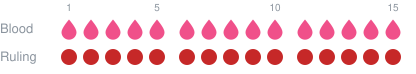

**③ Between two hayds there are at least 15 clean days (tuhr).**

<!-- strip: Blood: 15R 15C | Ruling: 15H 15T -->

Together, the longest hayd and the shortest tuhr fill one month. ar-Ramli gives exactly this as
the reason for the 15 days of tuhr: a month usually has a hayd and a tuhr in it.

Two more facts:

- There is **no longest tuhr**. A woman can be pure for months or years.
- The usual hayd is **6 or 7 days**.

**Age:** hayd is possible from about **nine lunar years** on. It is an approximate age: if she is
short of nine by less than about 16 days (the time of a hayd and a tuhr), the blood still counts.
There is no upper age.

📖 [Tuhfa 1/385](https://shamela.ws/book/9059/386) · [Nihaya 1/325-326](https://shamela.ws/book/3565/323) ·
[Mughni 1/278](https://shamela.ws/book/11444/194)

> **Good to know:** the days are counted in real hours. "15 days" means 360 hours from the moment
> the blood started, not "until the evening of the 15th calendar day". A day counts as a blood day
> when a piece of cotton would come out stained, even if nothing flows out (al-Kurdi via
> at-Tarmasi; basics.md).

---

## Lesson 2: The normal case: everything is hayd

**She bleeds for 6 days, then it stops.**

<!-- strip: Blood: 6R | Ruling: 6H -->
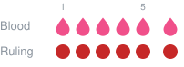

All 6 days are hayd. That is the rule for most months of most women:

> **If the blood lasts at least 24 hours and does not go beyond 15 days, all of it is hayd.**

What does **not** matter here:

**The colour.** 5 days black, then 4 days red, then it stops:

<!-- strip: Blood: 5K 4R | Ruling: 9H -->

**The order of the colours.** 5 red, 5 black, 5 red, then it stops:

<!-- strip: Blood: 5R 5K 5R | Ruling: 15H -->
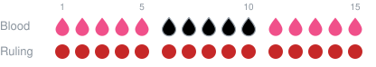

**Her habit.** If she usually bleeds 5 days and this month it is 9 days, all 9 are hayd, because
habits can change.

There is one exception: blood that comes back **too early after her last hayd** (lesson 6).

📖 [Mughni 1/284](https://shamela.ws/book/11444/200) · [Nihaya 1/339](https://shamela.ws/book/3565/337) ·
[Tuhfa 1/399](https://shamela.ws/book/9059/400) · [Tuhfa 1/402](https://shamela.ws/book/9059/403) ·
[FK 1/86](https://shamela.ws/book/21628/85), [FK 1/100](https://shamela.ws/book/21628/99)

> **Exactly 15 days?** Still all hayd. The limit is *exceeding* 15 days (Ibn Qasim on Tuhfa 1/399).

---

## Lesson 3: Too short: under 24 hours

**She bleeds for 20 hours, then it stops.**

That is **not hayd**. It is called **dam fasad** ("corrupt blood"). Any prayers she left during
these hours are made up.

> **Blood that does not reach 24 hours in total is not hayd.**

"In total" matters: if the blood comes and goes, the pieces are added up (lesson 4).

📖 [Mughni 1/278](https://shamela.ws/book/11444/194), [Mughni 1/289](https://shamela.ws/book/11444/205) ·
[Tuhfa 1/385](https://shamela.ws/book/9059/386) · [Nihaya 1/325](https://shamela.ws/book/3565/323)

---

## Lesson 4: Clean days in between

**3 days red, 5 clean days, 3 days red, then it stops.** What are the clean days?

<!-- strip: Blood: 3R 5C 3R | Default: 11H | Other view: 3H 5T 3H -->
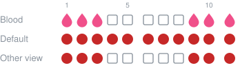

There are two views:

- **Default (the view the school relies on, "azhar"):** the clean days in between are **also hayd**.
  The hayd "stretches over" them. This is called *sahb*. All 11 days are hayd.
- **Other view (also strong, "laqt"):** only the blood days are hayd, the clean days are pure.

The clean days only become hayd if **all three** conditions hold:

| | Condition | In the example |
|---|---|---|
| 1 | Everything, from the first blood to the last, fits into **15 days** | 11 days ✅ |
| 2 | The blood days **together** reach **24 hours** | 6 days ✅ |
| 3 | The clean days lie **between** two bloods | ✅ |

Clean days **after** the last blood are always pure.

> **Clean** means really clean: the cotton comes out white. A short pause in which traces are still
> seen is not "clean" and is hayd on all views.

📖 [Tuhfa 1/412](https://shamela.ws/book/9059/413) · [Mughni 1/293-294](https://shamela.ws/book/11444/209) ·
[Nihaya 1/356](https://shamela.ws/book/3565/354)

---

## Lesson 5: Yellow and brownish discharge

**She sees only yellow discharge for 5 days.**

<!-- strip: Blood: 5Y | Default: 5H | Other view: 5F -->
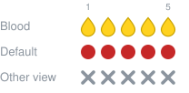

- **Default ("asahh"):** yellow and brownish discharge at a time when hayd is possible are **hayd**.
- **Other view (also strong):** they are not hayd, because they do not have the colour of blood.

The other view itself is read in two ways. al-Khatib says it only applies **outside** the days she
usually has her hayd; inside them yellow is hayd anyway. Ibn Hajar says it applies inside and outside.

📖 [Mughni 1/284-285](https://shamela.ws/book/11444/200) · [Nihaya 1/340](https://shamela.ws/book/3565/338) ·
[Tuhfa 1/400](https://shamela.ws/book/9059/401)

---

## Lesson 6: Blood that comes back too early

This is the trickiest lesson of Part 1. Take your time.

**The idea:** after a hayd, the next **15 days must be pure** (lesson 1, number ③). So if the blood
comes back before these 15 days are over, the blood that falls into them **cannot be hayd**. This is
called the *rest of the purity* (baqiyyat at-tuhr).

### Case A: the blood comes back and stops inside the 15 days

**3 red, 12 clean, 3 red, then it stops.**

<!-- strip: Blood: 3R 12C 3R | Ruling: 3H 12T 3F -->

- Days 1-3: hayd.
- Days 4-18 must be pure (15 days).
- The blood on days 16-18 falls inside them: **not hayd** (dam fasad).

Why not one hayd of 18 days? That would be more than 15. And why not a second hayd? There were no 15
pure days before it. All scholars agree on this case ("no khilaf in any of this", FK 1/86).

📖 [Mughni 1/284](https://shamela.ws/book/11444/200) · [Nihaya 1/339-340](https://shamela.ws/book/3565/337) ·
[Tuhfa 1/399](https://shamela.ws/book/9059/400) · [FK 1/86](https://shamela.ws/book/21628/85)

### Case B: the blood comes back and goes on after the 15 days are over

**10 red, 8 clean, 12 red, then it stops** (al-Ibana's own example).

<!-- strip: Blood: 10R 8C 12R | Ruling: 10H 8T 7F 5H -->
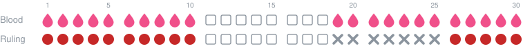

1. Days 1-10: hayd.
2. Days 11-25 must be pure (15 days after the end of the hayd).
3. The blood on days 19-25 falls inside them: not hayd (). It "completes the purity".
4. Days 26-30 come after a full purity: **a new hayd** ().

> **Recipe:** last day of the hayd + 15 = last day of the purity. Blood up to that day is not hayd.
> Blood after it starts again from lesson 2.

Another one: **3 red, 14 clean, 4 red.** The purity ends on day 18 (3 + 15). Day 18 is not hayd,
days 19-21 are hayd.

<!-- strip: Blood: 3R 14C 4R | Ruling: 3H 14T 1F 3H -->
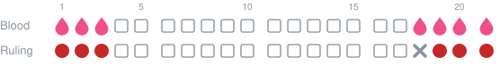

📖 Bughya 1/277 · al-Ibana p. 29-31 · Ibn Qasim on [Tuhfa 1/399](https://shamela.ws/book/9059/400) («لَا يَبْعُدُ»)

**Another reading, for a beginner only.** Two commentators on the Tuhfa (ash-Shabramallisi and
al-Bujayrimi) read Ibn Hajar's wording differently for a woman who is bleeding for the first time
(a *mubtada'a*). On their reading, she is a "mustahada" (lesson 7) from the very first day: only
day 1 is hayd, and the rest of the blood is not.

<!-- strip: Blood: 3R 14C 4R | Default: 3H 14T 1F 3H | Other reading: 1H 2F 14T 4F -->

### Which case is it? Look at where the returning blood starts

| The returning blood ... | Then |
|---|---|
| starts and ends **within the first 15 days** (counted from day 1) | one hayd including the clean days (lesson 4) |
| starts **after day 15** (counted from day 1), while the purity is not complete yet | this lesson (case A or B) |
| starts **within the first 15 days** and **runs past day 15** | treated as blood of more than 15 days (lesson 7). One form of it, 13 red / 1 clean / 5 red, is an open question |

---

# Part 2: more than 15 days

## Lesson 7: More than 15 days: the mustahada

**She bleeds for 16 days or more.** Now "everything is hayd" (lesson 2) no longer works, because no
hayd lasts more than 15 days. She is now called a **mustahada**, and the question becomes:

> **Which part of the blood is hayd?**

The answer depends on two things about her:

1. **Is this her first bleeding, or has she had a hayd before?**
   - A **beginner** (*mubtada'a*) has never had a hayd and a purity that she knows.
   - A woman with a **habit** (*mu'tada*) knows her earlier hayd and purity: how long, and when.
2. **Does her blood show a clear difference between strong and weak blood?** If it does and
   certain conditions hold, she has **tamyiz** (she is *mumayyiza*).

This gives the following map. Follow the arrows:

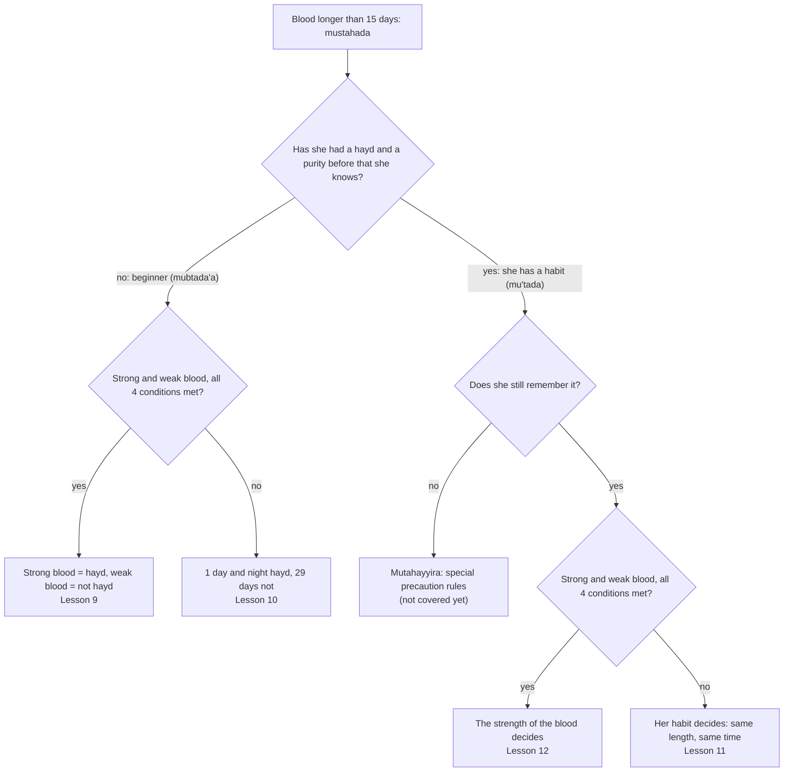

(GitHub draws this as a diagram. The school counts **seven** kinds of mustahada: the five end
points above, with the woman who forgot her habit split into three: she forgot its length, its
time, or both.)

**What she does while she cannot know yet.** On day 5 of her bleeding, nobody knows whether it will
stop on day 10 or go on to day 40. So she treats it as hayd for up to 15 days, as in lesson 2. Only
when the blood goes past day 15 does it become clear that she is a mustahada.

Once the blood has gone past 15 days, she is a mustahada even if it stops later (FK 1/102).

📖 [Mughni 1/285](https://shamela.ws/book/11444/201), [Mughni 1/289](https://shamela.ws/book/11444/205) ·
[Nihaya 1/340-341](https://shamela.ws/book/3565/338) · [Tuhfa 1/401](https://shamela.ws/book/9059/402),
[Tuhfa 1/402](https://shamela.ws/book/9059/403) · [FK 1/102](https://shamela.ws/book/21628/101)

---

## Lesson 8: Strong and weak blood

Blood is stronger or weaker by three qualities:

**Colour**, from strongest to weakest:

>  black →  red →  ashqar (reddish-yellow) →  yellow →  brownish

**Thickness:** thick is stronger than thin.

**Smell:** a bad smell is stronger than none.

How to compare:

- **More qualities = stronger.** Thick black with a bad smell is stronger than thick black.
- **Strength is relative.** Red is *weak* next to black, but *strong* next to yellow.
- **Equal = the earlier one wins.** The sources give examples of equal blood: thick black against
  black with a bad smell; thick (or smelly) red against plain black. In such a tie, the blood that
  came first counts as the strong one.
- **Weak means purely weak.** Red that still has streaks of black belongs to the black.

📖 [Tuhfa 1/402](https://shamela.ws/book/9059/403) · [Nihaya 1/341](https://shamela.ws/book/3565/339) ·
[Mughni 1/285](https://shamela.ws/book/11444/201)

---

## Lesson 9: Telling hayd by its strength (tamyiz)

**A beginner sees 10 days black, then red that goes on for weeks.**

<!-- strip: Blood: 10K 25R ... | Ruling: 10H 25F ... -->

> **The strong blood is hayd, the weak blood is not.**

All the red is not hayd, however long it lasts, because there is no longest tuhr (lesson 1).
Mughni 1/288 quotes the hadith «دَمُ الْحَيْضِ أَسْوَدُ يُعْرَفُ» ("the blood of hayd is black, it is
recognised").

### The four conditions

Tamyiz only counts if all four conditions are met. If one fails, she is treated like a woman
without tamyiz (lesson 10).

**① The strong blood lasts at least 24 hours.**
❌ Black for only 20 hours, then red that goes on: no tamyiz.

**② The strong blood does not go beyond 15 days.**
❌ 16 days black, then red:

<!-- strip: Blood: 16K 14R ... | Ruling: 1H 29F ... -->

(No tamyiz, so lesson 10 applies: only day 1 is hayd.)

**③ The weak blood lasts at least 15 days in a row** (only needed if the blood goes on).
❌ 1 black, 14 red, then black that goes on:

<!-- strip: Blood: 1K 14R 10K ... | Ruling: 1H 24F ... -->

The 14 red days would have to be a purity between two hayds, and a purity needs 15 days.

✅ But **10 black, 10 red, then it stops**: the red is only 10 days, but the blood did not go on,
so condition ③ is not needed:

<!-- strip: Blood: 10K 10R | Ruling: 10H 10F -->

**④ No strong blood inside the weak blood** (clean days in between do not matter).
❌ Black and red alternating day by day, on and on:

<!-- strip: Blood: 1K 1R 1K 1R 1K 1R 1K 1R 1K 1R 1K 1R 1K 1R 1K 1R 1K 1R 1K 1R ... | Ruling: 1H 19F ... -->

✅ But if the alternating stops **within the first 15 days** and only weak blood follows, the whole
alternating part is hayd (the red days in between are treated like clean days in lesson 4), and the
weak blood after it is not:

<!-- strip: Blood: 1K 1R 1K 1R 1K 1R 1K 1R 1K 1R 1K 14R ... | Ruling: 11H 14F ... -->

📖 [Tuhfa 1/401](https://shamela.ws/book/9059/402) · [Nihaya 1/341](https://shamela.ws/book/3565/339) ·
[Mughni 1/285-286](https://shamela.ws/book/11444/201) · [FK 1/100](https://shamela.ws/book/21628/99) ·
al-Ibana p. 71-72

### The strong blood does not have to come first

**5 red, 5 black, then red that goes on:** the black is hayd. The red before it is not.

<!-- strip: Blood: 5R 5K 20R ... | Ruling: 5F 5H 20F ... -->

**15 red, 15 black, then it stops:** the black is hayd.

<!-- strip: Blood: 15R 15K | Ruling: 15F 15H -->

📖 [Tuhfa 1/402](https://shamela.ws/book/9059/403) · [Nihaya 1/341-342](https://shamela.ws/book/3565/339) ·
[FK 1/102](https://shamela.ws/book/21628/101), [FK 1/105](https://shamela.ws/book/21628/104)

### Three strengths: black, red and yellow

The middle one (red) can join the strong one (black), if it **follows it directly** and both
**together stay within 15 days**.

**5 black, 5 red, then yellow that goes on:** black and red are hayd.

<!-- strip: Blood: 5K 5R 20Y ... | Ruling: 10H 20F ... -->

**10 black, 6 red, then yellow:** together 16 days, too long. Only the black is hayd.

<!-- strip: Blood: 10K 6R 14Y ... | Ruling: 10H 20F ... -->

**5 black, 5 yellow, then red that goes on:** here the scholars differ.

<!-- strip: Blood: 5K 5Y 20R ... | ar-Ramli, al-Khatib (default): 5H 25F ... | Ibn Hajar: 10H 20F ... -->
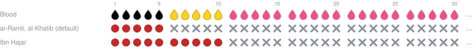

ar-Ramli and al-Khatib: the blood next in strength after the black is the red, and it does not follow
the black directly, so only the black. Ibn Hajar: black and yellow together.

📖 [Nihaya 1/342](https://shamela.ws/book/3565/340) · [Mughni 1/286](https://shamela.ws/book/11444/202) ·
[Tuhfa 1/403-404](https://shamela.ws/book/9059/404)

### Strong, weak, strong

**7 black, 7 red, 7 black, then it stops** (21 days):

<!-- strip: Blood: 7K 7R 7K | ar-Ramli, al-Khatib (default): 14H 7F | Ibn Hajar: 7H 14F -->
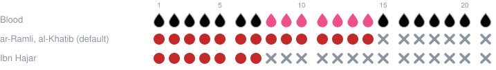

**8 black, 8 red, 8 black, then it stops:** black and red together would be 16 days, so all agree
that only the first black is hayd. (Day 24 is an open question.)

<!-- strip: Blood: 8K 8R 8K | Ruling: 8H 16F -->

📖 [Tuhfa 1/401](https://shamela.ws/book/9059/402) · [Nihaya 1/342](https://shamela.ws/book/3565/340) ·
[Mughni 1/286](https://shamela.ws/book/11444/202) · [FK 1/86](https://shamela.ws/book/21628/85),
[FK 1/102](https://shamela.ws/book/21628/101) · al-Ibana p. 71

---

## Lesson 10: A beginner without tamyiz

**A beginner bleeds red for weeks, always the same.** There is no strong and weak blood to go by.

<!-- strip: Blood: 35R ... | Ruling: 1H 29F 1H 4F ... -->

> **Her hayd is one day and night from the start of the blood, then 29 days are not hayd. Then the
> next day and night is hayd again, and so on.**

Why only one day? That much is certain; everything beyond it is in doubt. Why 29? The cycle of a
mustahada is always **30 days**.

**Other view (also strong):** her hayd is the usual **6 or 7 days**, and the rest of the month is not hayd.

A case to think through: **15 red, then 15 black, then the black goes on.** While it happens she stops
praying for the whole first month: first the red (it could be hayd), then the black (it looks like a
tamyiz). When the black goes past 15 days, condition ② of tamyiz fails. So she has no tamyiz: her hayd
is one day and night at the start of each month, and she makes up the prayers and fasts.

📖 [Tuhfa 1/404](https://shamela.ws/book/9059/405), [Tuhfa 1/402-403](https://shamela.ws/book/9059/403) ·
[Mughni 1/286-287](https://shamela.ws/book/11444/202) · [Nihaya 1/342](https://shamela.ws/book/3565/340) ·
[FK 1/104](https://shamela.ws/book/21628/103)

---

## Lesson 11: A woman with a habit ('ada)

**Her hayd was 5 days at the start of the month, then the rest of the month pure. Now the blood goes
on and on, all the same colour.**

<!-- strip: Blood: 35R ... | Ruling: 5H 25F 5H ... -->

> **She goes back to her habit: the same number of days, at the same place in her cycle.**

📖 [Tuhfa 1/404](https://shamela.ws/book/9059/405) · [Mughni 1/287](https://shamela.ws/book/11444/203) ·
[FK 1/110](https://shamela.ws/book/21628/109)

### One time is enough

A single hayd with a following purity makes a habit (default, "asahh"). The other views (also
strong) want two or three times. Example: her hayd was 5 days, then 6, then 7, then the blood goes on:

| View | She goes back to |
|---|---|
| one time is enough (default) | 7 days (the last one) |
| two times needed | 6 days |
| three times needed | 5 days |

📖 [Nihaya 1/345](https://shamela.ws/book/3565/343) · [Mughni 1/288](https://shamela.ws/book/11444/204) ·
[FK 1/110](https://shamela.ws/book/21628/109)

### When the blood comes earlier than usual

**Habit 5 days, then only 14 clean days, then the blood comes back and goes on.**

<!-- strip: Blood: 5R 14C 26R ... | Ruling: 5H 14T 1F 5H 15F 5H ... -->
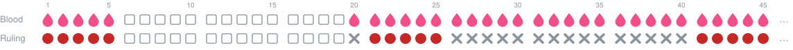

1. Days 1-5: hayd. Days 6-19: clean.
2. The purity needs one more day: day 20 is not hayd (lesson 6).
3. Then her habit: 5 days hayd (21-25), then 15 days not hayd. Her new cycle is 20 days.

**Habit 5 days, then 20 clean days, then the blood comes back and goes on.** Her hayd came early;
her new cycle is 25 days.

<!-- strip: Blood: 5R 20C 30R ... | Ruling: 5H 20T 5H 20F 5H ... -->
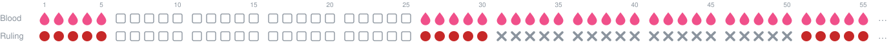

Ibn Hajar (FK 1/78, 1/91) reports **three further strong views** for both cases. Example for the first
case: some keep her old cycle, so the returning blood up to the end of the month is not hayd and her
hayd starts again at the start of the next month. The other two give different lengths of hayd or
purity (khilaf.md lists them).

📖 [Tuhfa 1/399](https://shamela.ws/book/9059/400) · [FK 1/111](https://shamela.ws/book/21628/110),
[FK 1/78](https://shamela.ws/book/21628/77), [FK 1/91](https://shamela.ws/book/21628/90)

---

## Lesson 12: Habit against tamyiz

**Her habit is 5 days. Now she sees 10 days black, then red that goes on.** The habit says 5, the
blood says 10. Who wins?

<!-- strip: Blood: 10K 20R ... | Default (tamyiz): 10H 20F ... | Other view (habit): 5H 25F ... -->
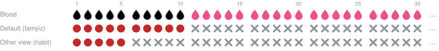

- **Default ("asahh"):** the **tamyiz** wins. It is a sign in the blood itself; the habit is only a
  sign in the woman.
- **Other view (also strong):** the habit wins, because it is established and settled.

**If a full purity lies between them, both count.** Habit of 5 days, then 20 days red, then 5 days
black, then red:

<!-- strip: Blood: 5R 20R 5K 5R ... | Ruling: 5H 20F 5H 5F ... -->

The 20 red days are a full purity (at least 15), so the habit days **and** the black days are hayd.

📖 [Nihaya 1/345](https://shamela.ws/book/3565/343) · [Mughni 1/288-289](https://shamela.ws/book/11444/204)

---

# Part 3: overview

## Lesson 13: All points with more than one view

In some places the school has more than one view. The books mark the view they rely on (words like
"asahh" or "azhar"); the other view is still considered strong. And sometimes the main scholars of
the later school differ among themselves: Ibn Hajar on one side, ar-Ramli and al-Khatib on the other.

| Question | Default | Other view | Lesson |
|---|---|---|---|
| Clean days between bloods within 15 days | hayd | pure | 4 |
| Yellow and brownish discharge | hayd | not hayd | 5 |
| ... and if not hayd: also inside her habit days? | no, only outside (al-Khatib) | inside too (Ibn Hajar) | 5 |
| A beginner whose blood comes back too early and goes past the purity | first blood hayd, the rest completes the purity | only day 1 is hayd (two commentators' reading) | 6 |
| Beginner without tamyiz | 1 day and night | 6 or 7 days | 10 |
| How often until a habit counts | once | twice; three times | 11 |
| Blood comes earlier than her habit and goes on | new cycle | three further views | 11 |
| Habit against tamyiz | tamyiz | habit | 12 |
| 7 black, 7 red, 7 black | black + red (ar-Ramli, al-Khatib) | only the first black (Ibn Hajar) | 9 |
| 5 black, 5 yellow, then red | only black (ar-Ramli, al-Khatib) | black + yellow (Ibn Hajar) | 9 |

The calculator lets you pick each view in its settings (`HaydCalculatorSettings`). The full list,
with every source, is in [khilaf.md](khilaf.md).

---

## Lesson 14: What is not covered yet

- **Nifas** (blood after childbirth) and blood in pregnancy: collected in [nifas.md](nifas.md), not in
  the calculator yet. One rule to know: between a hayd and nifas, the purity can be shorter than 15
  days.
- **The woman who forgot her habit** (*mutahayyira*): special precaution rules; not covered yet.
- **Open questions**: cases the sources checked so far do not settle, e.g. 13 red, 1 clean, 5 red,
  then it stops. They are listed with all passages in [open-questions.md](open-questions.md).

---

# Exercises

Draw the days on paper first. Default views unless the exercise says otherwise.

**1.** 6 days red, then it stops.

Solution

<!-- strip: Blood: 6R | Ruling: 6H -->

At least 24 hours, not more than 15 days: all hayd (lesson 2).

**2.** 3 red, 5 clean, 3 red, then it stops.

Solution

<!-- strip: Blood: 3R 5C 3R | Default: 11H | Other view: 3H 5T 3H -->

All three conditions of lesson 4 hold.

**3.** 3 red, 12 clean, 3 red, then it stops.

Solution

<!-- strip: Blood: 3R 12C 3R | Ruling: 3H 12T 3F -->

The last 3 days fall into the 15 days of purity (lesson 6, case A).

**4.** 10 red, 8 clean, 12 red, then it stops.

Solution

<!-- strip: Blood: 10R 8C 12R | Ruling: 10H 8T 7F 5H -->

Purity until day 25; days 19-25 complete it; days 26-30 are a new hayd (lesson 6, case B).

**5.** A beginner bleeds red for 40 days, always the same.

Solution

<!-- strip: Blood: 40R | Ruling: 1H 29F 1H 9F -->

No tamyiz: one day and night hayd, 29 days not (lesson 10).

**6.** A beginner: 10 black, then red that goes on.

Solution

<!-- strip: Blood: 10K 25R ... | Ruling: 10H 25F ... -->

All four conditions of tamyiz hold (lesson 9).

**7.** A beginner: black and red alternate day by day for 40 days.

Solution

<!-- strip: Blood: 1K 1R 1K 1R 1K 1R 1K 1R 1K 1R 1K 1R 1K 1R 1K 1R 1K 1R 1K 1R 1K 1R 1K 1R 1K 1R 1K 1R 1K 1R 1K 1R 1K 1R 1K 1R 1K 1R 1K 1R | Ruling: 1H 29F 1H 9F -->

Condition ④ fails: no tamyiz, so like exercise 5 (lessons 9 and 10).

**8.** A beginner: 7 black, 7 red, 7 black, then it stops.

Solution

<!-- strip: Blood: 7K 7R 7K | Default: 14H 7F | Ibn Hajar: 7H 14F -->
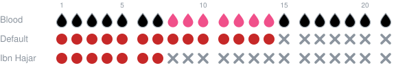

Lesson 9, "Strong, weak, strong".

**9.** Her habit is 5 days. Now: 10 black, then red that goes on.

Solution

<!-- strip: Blood: 10K 20R ... | Default (tamyiz): 10H 20F ... | Other view (habit): 5H 25F ... -->

Lesson 12.

**10.** Her habit is 5 days. Then 14 clean days, then blood that goes on.

Solution

<!-- strip: Blood: 5R 14C 26R ... | Ruling: 5H 14T 1F 5H 15F 5H ... -->

Day 20 completes the purity, then her habit of 5 days, cycle 20 (lesson 11).

**11.** Trick question: 13 red, 1 clean, 5 red, then it stops.

Solution

The returning blood starts within the first 15 days and runs past day 15. This exact case is an
**open question**: some passages make her a mustahada (lesson 7), another passage would make the 5
days not hayd (lesson 6). See [open-questions.md](open-questions.md), question 1.

---

# Cheat sheet

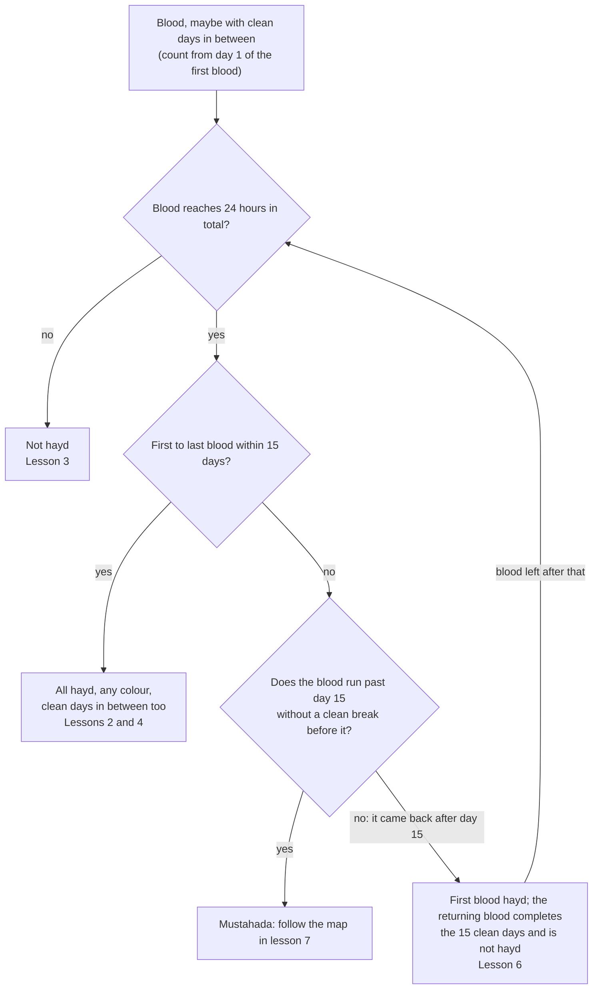

| Number | Value |
|---|---|
| Shortest hayd | 24 hours |
| Longest hayd | 15 days |
| Shortest purity between two hayds | 15 days |
| Longest purity | none |
| Usual hayd | 6 or 7 days |
| Cycle of a mustahada without habit | 30 days |
| Youngest age | about 9 lunar years |

---

# Glossary

| Word | Meaning |
|---|---|
| **'ada** | her habit: how long her hayd and her purity usually last, and when |
| **dam fasad** | "corrupt blood": blood that cannot be hayd |
| **hayd** | menstruation |
| **istihada** | blood that is not hayd; she prays and fasts |
| **khilaf** | a difference of views among the scholars |
| **mubtada'a** | a beginner: bleeding for the first time |
| **mu'tada** | a woman with a habit |
| **mumayyiza** | a woman whose blood shows tamyiz |
| **mustahada** | a woman whose blood goes beyond 15 days |
| **mutahayyira** | a mustahada who forgot her habit |
| **naqa'** | really clean: the cotton comes out white |
| **nifas** | blood after childbirth |
| **sahb** | the view that clean days between bloods are hayd |
| **laqt** | the view that clean days between bloods are pure |
| **tamyiz** | telling hayd from not-hayd by the strength of the blood |
| **tuhr** | purity: the time between two hayds |
